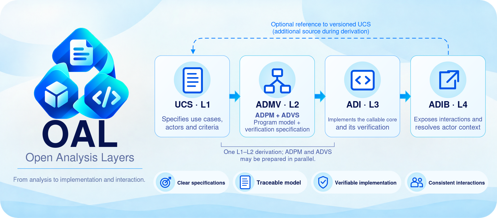
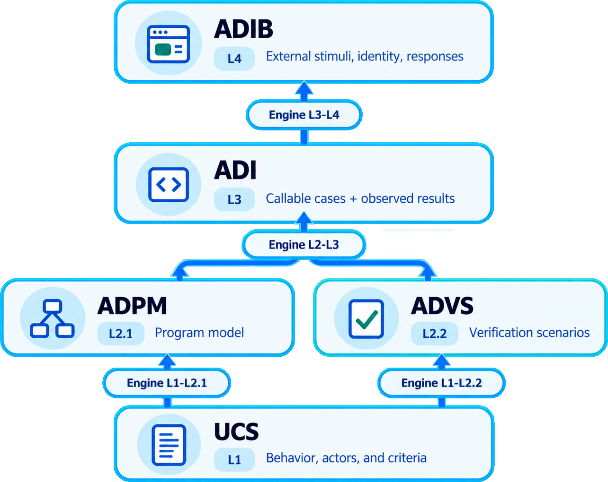
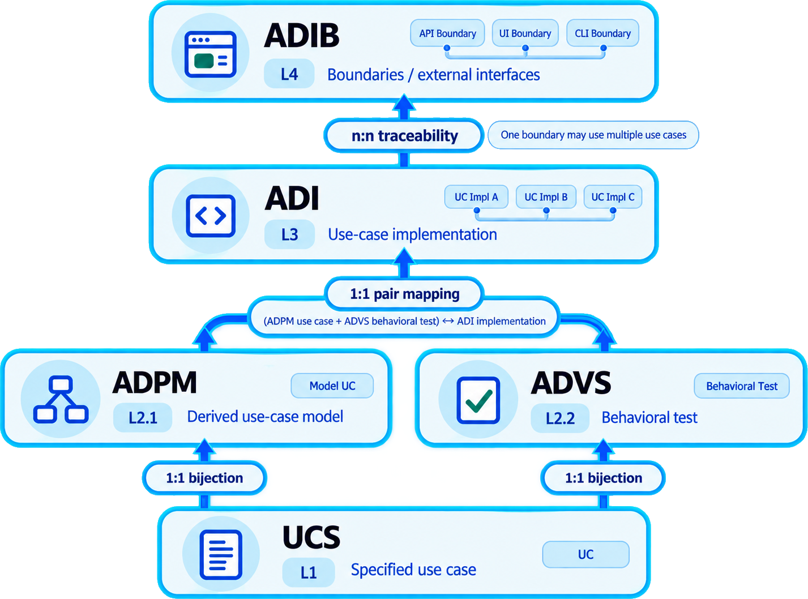

<strong>OAL Stable-v1.0.0</strong> English · <a href="README.pt-br.md">Português brasileiro</a>

# OAL — Open Analysis Layers

OAL connects four layers of development responsibility: use-case specification (L1), program modeling and verification specification combined as ADMV (L2), the callable core (L3), and interaction channels (L4). Each layer defines a metamodel; a reusable model conforms to a layer, and concrete project artifacts instantiate the selected model. Client needs are not a layer: a Needs-to-L1 derivation consumes a declared external needs model. Each derivation records its sources, decisions, and responsible person. Teams can use the model with different languages, tools, documents, and folder layouts.

## Contents

- [The layers](#the-layers)
- [Case mapping and cardinality](#case-mapping-and-cardinality)
- [Derivation engines](#derivation-engines)
- [Translations and combined implementations](#translations-and-combined-implementations)
- [Versions](#versions)
- [Informational skill](#informational-skill)
- [Examples](#examples)
- [Frequently asked questions](#frequently-asked-questions)
- [Authors and credits](#authors-and-credits)

## The layers

The diagram groups ADPM and ADVS inside L2 · ADMV. One Engine L1-L2 produces both components; Engine L2-L3 consumes the complete ADMV.

| Layer | What it contributes |
| --- | --- |
| **L1 · UCS** | Defines use cases: objectives, actors and permissions, behavior, domain rules, outcomes, and acceptance criteria. It describes the observable contract and records externally imposed interaction restrictions with their origin. Interaction choices introduced by the solution belong to L4; code organization belongs to L3. |
| **L2 · ADMV** | Combines **ADPM**, the program model, and **ADVS**, the verification specification. ADPM models case decisions, entities, tools, contracts, and composition; ADVS defines one directly linked behavioral test per UCS case, with supporting subtests as needed. Both components are required to claim L2. |
| **L3 · ADI** | Realizes the modeled cases as a callable application core under a selected reusable code organization. It preserves ADPM distinctions and mappings, enforces case permissions, and records observed verification results. |
| **L4 · ADIB** | Builds the external interaction boundary: pages, endpoints, commands, messages, or other channels. It receives requests, invokes L3 cases, and presents results while keeping channel decisions outside the core. |

**Each layer defines a metamodel.** A reusable model $M_i$ that satisfies layer $L_i$ is instantiated by concrete project artifacts $a$: $M_i \models L_i$, and $a \models M_i$. The layer number names a development responsibility; the metamodel-model-artifact chain names instantiation — L1 is not the metalevel above L2. An artifact may be a set of files and may have several representations (JSON, Markdown, TeX) of the same content. When this README says, for example, "an L3 artifact", it means an artifact of a model associated with L3.

Read $\models$ as “satisfies the requirements of” and $A(M_i)$ as the class of artifacts conforming to the selected model. The relation “is an artifact of” is expressed by membership:

$$
a \in A(M_i) \iff a \models M_i.
$$

Here $\in$ means “belongs to” and $\iff$ means “if and only if”. The [notation guide](versioning/Stable-v1.0.0/README.md#mathematical-notation) defines the symbols, with edition, versions, scope, and evidence made explicit.

**ADPM and ADVS are components of L2, not separate layers.** They may be prepared in parallel from L1, and there is a single L1-to-L2 derivation. Within a declared scope, each use case has one corresponding ADPM case, one ADVS behavioral test, and one ADI case. Supporting subtests are not behavioral tests because they do not link directly to a UCS case. An ADIB interface element can invoke several cases, and a case can be exposed by several elements. These links preserve case identity without forcing the same file or class structure in every project. See the [cross-layer rules](versioning/Stable-v1.0.0/README.md#oal-layers), [L2 rules](versioning/Stable-v1.0.0/README.md#admv), [ADPM rules](versioning/Stable-v1.0.0/README.md#adpm), and [ADVS rules](versioning/Stable-v1.0.0/README.md#advs).

The ADPM separation among cases, tools, entities, and optional domains must remain identifiable in ADI and across ADIB. ADIB derives its interaction boundary from ADI's callable cases and may also consult UCS. ADIB is not a copy of ADI. The [ADI rules](versioning/Stable-v1.0.0/README.md#adi) and [ADIB rules](versioning/Stable-v1.0.0/README.md#adib) define these boundaries.

## Case mapping and cardinality

The image maps case identities through the four layers. Both components of L2 retain their case links: one UCS case corresponds to one ADPM case, one ADVS behavioral test, and one ADI case. The one-to-one links concern **use-case identities**; supporting checks may be numerous, and the per-case cardinality does not mean one behavioral test per function. Between ADI cases and ADIB interface elements, the mapping is many to many.

## Derivation engines

An **OAL engine** is a metamodel that specifies how a deterministic transformer is constructed from a selected source model to a selected destination model, and how that transformer is executed on artifacts. It may be realized by a human process, software, or both. Construction and execution are distinct moments:

For a transition between adjacent OAL layers, the selected models satisfy their respective layer metamodels:

$$
M_n \models L_n,
\qquad
M_{n+1} \models L_{n+1}.
$$

**Construction.** A successful construction according to engine $E$ is written as:

$$
\mathrm{Build}_E(M_n, M_{n+1})
\longrightarrow T[M_n, M_{n+1}].
$$

The arrow records one construction with its fixed choices. Other choices may produce a different transformer, and construction may fail. $\mathrm{Build}$ names the construction operation specified by the engine; it does not prescribe an executable factory.

**Execution.** Let $T = T[M_n, M_{n+1}]$ be that constructed transformer. Under its declared preconditions and operational conditions:

$$
T(a) = b,
\qquad
a \in D_T \subseteq A(M_n),
\qquad
b \in A(M_{n+1}).
$$

Here $D_T$ is the supported input domain, $a$ is the source artifact, and $b$ is the produced artifact. The output satisfies the selected destination model: $b \models M_{n+1}$. Valid source artifacts outside $D_T$ remain outside the coverage claim. The notation describes successful execution; the declared failure categories still apply.

The transformer $T$ is specialized for the selected pair of models. Construction freezes mapping, representation, technology, and policy decisions; execution applies $T$ to a valid input of the supported domain and must terminate with an artifact that satisfies the **selected destination model** and preserves the announced obligations (identities, contracts, criteria, permissions). An engine claim states its determinism criterion, coverage domain, failure classification, and traceability. Production does not imply literal translation: L4 adds interaction choices that do not exist in L3.

| Engine | Inputs → output |
| --- | --- |
| **Engine Needs-L1** | Artifacts of a declared external needs model ($M_{\mathrm{Needs}}$) → UCS specification (L1). Client needs are not an OAL layer; needs reconstructed from a UCS remain identified as reconstructed. |
| **Engine L1-L2** | UCS → ADMV (L2), including **both** ADPM and ADVS, in a single derivation. The components may be prepared in parallel. |
| **Engine L2-L3** | Complete ADMV (ADPM **and** ADVS) → ADI (L3); UCS (L1) may be consulted as an additional versioned source. |
| **Engine L3-L4** | ADI → ADIB (L4); UCS (L1) may be consulted as an additional versioned source. |

A concrete derivation records source and destination versions, scope, added decisions, and an accountable person — separately from any claim that a transformer was constructed or executed. A conformance claim names its object: a reusable model evaluated against a layer metamodel, an artifact evaluated against its selected model, or a transformer construction, execution, or composition evaluated against the applicable engine requirements. Each claim states the edition, selected models and versions, scope, preserved links, and supporting evidence. Manual derivation records remain distinct from transformer claims. See the [engine rule](versioning/Stable-v1.0.0/README.md#oal-layers) and [versioning guide](versioning/Stable-v1.0.0/README.md#versioning).

## Translations and combined implementations

Models satisfying the same layer share its defining responsibilities. Artifacts of two selected models may be translated through an explicit mapping for a declared domain, even when their languages or formats differ. Sharing the layer label alone does not presume a universal translator. Such a translation records which shared characteristics survive and which details are lost or changed. A conversion between representations of one model is a different operation: it preserves the model content under a declared equivalence, not byte or editorial identity. The same applies to implementations of the same named engine.

One specialization may cover neighboring layers without constructing the transformer between them. A combined model or package that merely gathers artifacts demonstrates coexistence, not transformation. If the specialization needs to perform the transition internally, it may construct a transformer according to the engine metamodel and record evidence for its source, destination, and transition. This is optional even when both layers are informational, as with L1 and L2. A claim of L2 coverage includes **both** ADPM and ADVS. A composition of transformers, such as $T_{13}(a) = T_{23}(T_{12}(a))$, is a separate claim: it requires a declared domain $D_{13} \subseteq \{a \in D_{12} \mid T_{12}(a) \in D_{23}\}$, a compatible intermediate model and version, compatibility between the equivalence used by $T_{12}$ and $T_{23}$'s input expectations (or a canonical form), failure handling, and preserved traces. See the [cross-layer rules](versioning/Stable-v1.0.0/README.md#oal-layers).

## Versions

| Edition | Status | Release Notes | Reference rules | Verification Guide | Conformance Guide |
| --- | --- | --- | --- | --- | --- |
| Stable-v1.0.0 | Current stable version | [English](versioning/Stable-v1.0.0/README.md#release-notes) · [Português](versioning/Stable-v1.0.0/README.pt-br.md#notas-da-versao) | [English](versioning/Stable-v1.0.0/README.md#reference-rules) · [Português](versioning/Stable-v1.0.0/README.pt-br.md#reference-rules) | [English](versioning/Stable-v1.0.0/README.md#verification) · [Português](versioning/Stable-v1.0.0/README.pt-br.md#verification) | [English](versioning/Stable-v1.0.0/README.md#conformance) · [Português](versioning/Stable-v1.0.0/README.pt-br.md#conformance) |
| Alpha-v0.2.0-Alkimim | Historical alpha version | [English](versioning/Alpha-v0.2.0-Alkimim/README.md#release-notes) · [Português](versioning/Alpha-v0.2.0-Alkimim/README.pt-br.md#notas-da-versao) | [English](versioning/Alpha-v0.2.0-Alkimim/README.md#reference-rules) · [Português](versioning/Alpha-v0.2.0-Alkimim/README.pt-br.md#reference-rules) | [English](versioning/Alpha-v0.2.0-Alkimim/README.md#verification) · [Português](versioning/Alpha-v0.2.0-Alkimim/README.pt-br.md#verification) | [English](versioning/Alpha-v0.2.0-Alkimim/README.md#conformance) · [Português](versioning/Alpha-v0.2.0-Alkimim/README.pt-br.md#conformance) |
| Alpha-v0.1.0-Alkimim | First alpha version | [English](versioning/Alpha-v0.1.0-Alkimim/README.md#release-notes) · [Português](versioning/Alpha-v0.1.0-Alkimim/README.pt-br.md#notas-da-versao) | [English](versioning/Alpha-v0.1.0-Alkimim/README.md#reference-rules) · [Português](versioning/Alpha-v0.1.0-Alkimim/README.pt-br.md#reference-rules) | [English](versioning/Alpha-v0.1.0-Alkimim/README.md#verification) · [Português](versioning/Alpha-v0.1.0-Alkimim/README.pt-br.md#verification) | [English](versioning/Alpha-v0.1.0-Alkimim/README.md#conformance) · [Português](versioning/Alpha-v0.1.0-Alkimim/README.pt-br.md#conformance) |

English is the source text; Portuguese is its translation. The runnable examples of this edition are under `versioning/<edition>/examples/`.

## Informational skill

The [informational Agent Skill](versioning/Stable-v1.0.0/skill/SKILL.md) describes this edition's layers, models, artifacts, engines, actors, boundaries, mathematical notation, and evidence limits. Its self-contained folder includes `SKILL.md`, the license, and supporting references. It contains descriptive knowledge without an executable workflow; the edition's numbered requirements remain the authority for conformance.

The root [content inventory](CONTENT-SHA256.json) records the path, byte size, and SHA-256 digest of every delivered file, including the skill. Only the inventory itself is excluded.

Install the skill by copying the complete versioning/Stable-v1.0.0/skill/ directory into the skills directory supported by your environment, named oal-stable-v1-0-0. Preserve SKILL.md, LICENSE.txt, and references/; there is no universal installation path.

## Examples

The repository includes Tiny Catalog, Board CRM, and Work Board. These packages present project artifacts that instantiate four reusable models (M1–M4) under `versioning/Stable-v1.0.0/examples/models/`; each project declares its four instances in `model-instances.json`. The models were applied manually, so the records do not demonstrate constructed or executed transformers. Their artifacts, features, demonstration credentials, and execution instructions are in the [examples guide](versioning/Stable-v1.0.0/examples/README.md). List this edition's examples with `python versioning/Stable-v1.0.0/run_examples.py --list` and run one with `python versioning/Stable-v1.0.0/run_examples.py NAME`. Choose another edition through its own launcher path. See [release guide](docs/releasing.md) for archive verification.

## Frequently asked questions

Is OAL a fixed folder structure?

No. The layers name responsibilities. A project can combine or split physical files and modules while keeping their contracts and derivations identifiable.

What is the difference between a layer, a model, and an artifact?

A layer $L_i$ defines a metamodel — the requirements a reusable model must satisfy. A model $M_i$ conforming to $L_i$ is reusable across projects. A concrete artifact $a$ instantiates one selected model: $M_i \models L_i$, and $a \models M_i$. "An L3 artifact" is shorthand for an artifact of a model associated with L3.

Are client needs a layer?

No. Needs are the source material of a derivation. Engine Needs-L1 consumes artifacts of a declared external needs model and produces UCS artifacts. Needs reconstructed from an existing UCS remain identified as reconstructed.

Are the example models part of OAL?

No. The four models under `versioning/Stable-v1.0.0/examples/models/` are reusable didactic models that declare conformance to this edition. Each project declares four instances in `model-instances.json`. Specifying a model and assessing its instances are separate operations, and the records do not demonstrate a transformer.

Must ADPM use pseudocode or prescribe a code organization?

No. Semantic prose and structured pseudocode are both valid if they specify cases, entities, tools, contracts, dependency wiring, permissions, and algorithms. ADPM distinguishes those responsibilities; the selected L3 model defines a reusable code organization, and its concrete artifacts preserve the mapping.

Why does L2 contain both ADPM and ADVS?

ADPM models the program and ADVS plans verification. They can be prepared in parallel from UCS, but together they define ADMV (L2). Both inform ADI; a claim to cover L2 includes both.

Can one use case have multiple behavioral tests?

No. One UCS use case has one directly linked ADVS behavioral test. That test can consume many supporting subtests, which are not behavioral tests themselves. Checks focused on tools, entities, or interface channels can also be recorded without creating another behavioral test for the case.

What qualifies as an OAL engine implementation?

It identifies the named transition and edition, accepted inputs, produced outputs, preserved links, added decisions, and validation scope. It separates the construction of a transformer for a selected pair of models from its execution, and states its determinism criterion, coverage domain, preservation obligations, and failure classification. Each project derivation also identifies a responsible person and source and destination versions.

Where does domain validation belong?

In the entity or in the use case that consumes it — never in a tool. Tools provide the technical guarantees of their contracts, such as atomic uniqueness and transactions, whose domain meaning is defined in the core. Channel concerns (JSON, encoding, body format) belong to L4, and record shape belongs to codecs under a representation contract.

Who is the actor?

An actor is an interaction role declared in the specification and played by a person or system when requesting a use case. The concrete caller is represented by an actor context resolved according to the contract. The context identifies the relevant roles and, when required, the caller identity and authentication information. Each case declares its permitted actors and authorization conditions. Missing, unresolved, unknown, or insufficient contexts are denied. An anonymous actor is allowed only when explicitly declared and permitted; absence of context does not mean anonymous access. The person responsible for deriving an artifact is named separately.

Is ADIB limited to a programmatic API?

No. It covers pages, programmatic endpoints, commands, messages, and other interaction channels. OAL uses ADIB for this broader boundary.

Does ADIB need one interface element per use case?

No. One element may invoke several specified cases, and one case may be exposed by several elements. Record links in both directions and identify interface-only elements separately.

Where do authentication and authorization belong?

ADIB resolves the actor context through the declared channel mechanism, authenticates the caller when the contract requires it, and passes the context to ADI. A direct invocation also supplies a context through the model’s declared trusted path. The case in ADI applies its own authorization policy before domain effects. A case calling another case preserves the pertinent context; the called case applies its own policy. Routes, pages, formatting, and technical session state belong to ADIB. Storage used exclusively for channel state has an explicit technical contract; business data remains accessed through cases.

Does a passing test prove the whole model?

No. It supports the observed check and configuration. ADVS records planned checks; ADI and ADIB report executions for the boundaries and environments they claim.

Are the Python examples prescribed implementations?

No. They show possible language, storage, and browser choices. The reference rules allow other choices.

## Authors and credits

OAL was conceived and written by **Douglas de Oliveira Alkimim** and **Bruno Chevitarese**. See the [citation metadata](CITATION.cff) and [MIT license](LICENSE).

---
 

<strong>Douglas de Oliveira Alkimim</strong> 
&nbsp;
 
 

---
 

<strong>Bruno Chevitarese</strong> 
&nbsp;
 
 

---
