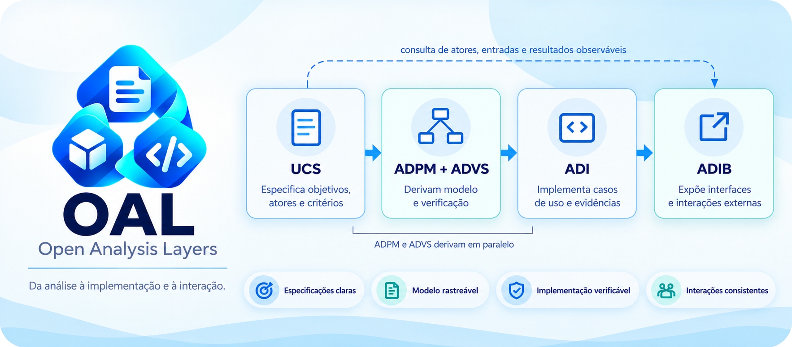
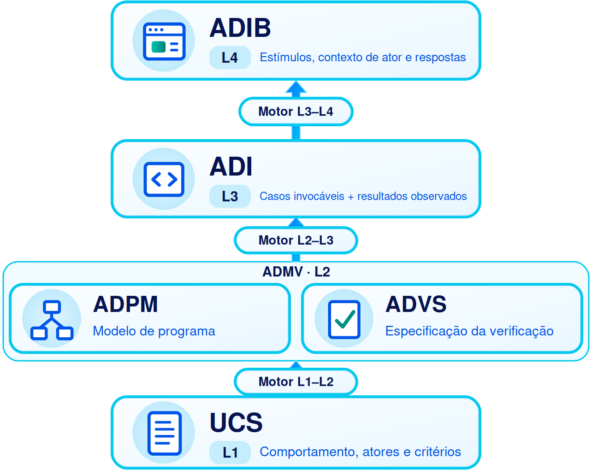
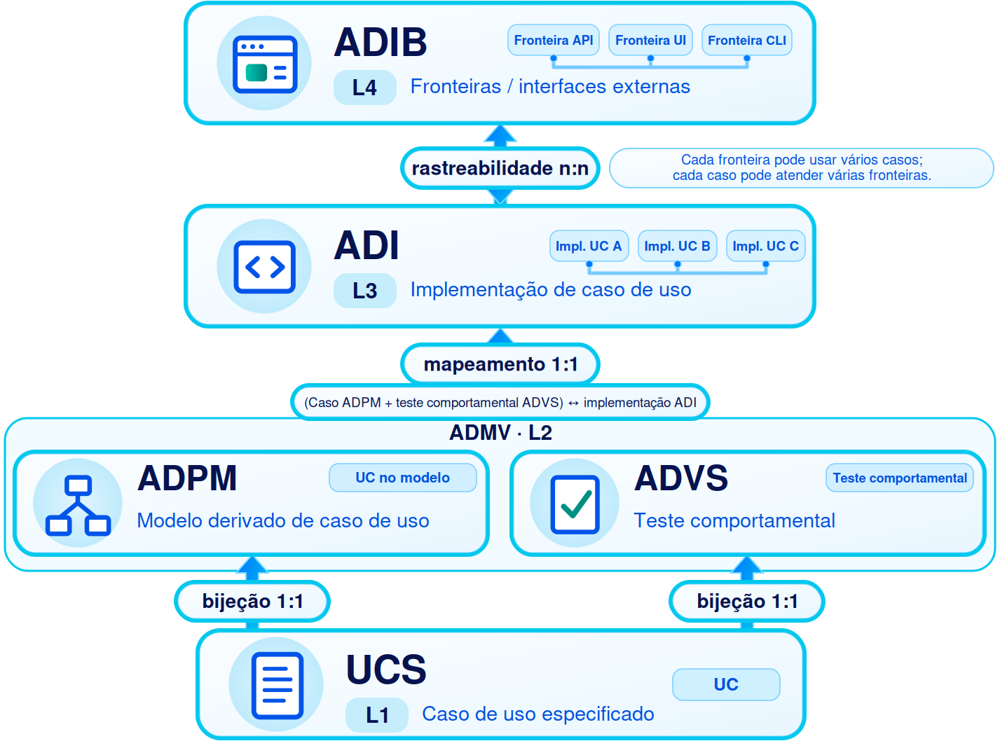

<strong>OAL Alpha-v0.2.0-Alkimim</strong> Português brasileiro · <a href="README.md">English</a>

# OAL — Open Analysis Layers

OAL conecta quatro camadas de responsabilidade de desenvolvimento: especificação de casos de uso (L1), modelagem do programa e especificação da verificação reunidas como ADMV (L2), núcleo invocável (L3) e canais de interação (L4). Cada camada define um metamodelo; um modelo reutilizável é conforme a uma camada, e artefatos concretos de projeto instanciam o modelo selecionado. As necessidades do cliente não são uma camada: uma derivação Needs-to-L1 consome um modelo externo de necessidades declarado. Cada derivação registra suas fontes, decisões e pessoa responsável. Equipes podem aplicar o modelo com linguagens, ferramentas, documentos e estruturas de pastas diferentes.

## Sumário

- [As camadas](#as-camadas)
- [Correspondência e cardinalidade dos casos](#correspondência-e-cardinalidade-dos-casos)
- [Motores de derivação](#motores-de-derivação)
- [Traduções e implementações conjuntas](#traduções-e-implementações-conjuntas)
- [Versões](#versões)
- [Skill informativa](#skill-informativa)
- [Exemplos](#exemplos)
- [Perguntas frequentes](#perguntas-frequentes)
- [Autoria e créditos](#autoria-e-créditos)

## As camadas

O diagrama reúne ADPM e ADVS na L2 · ADMV. Um Motor L1-L2 produz ambos os componentes; o Motor L2-L3 consome a ADMV completa.

| Camada | O que acrescenta |
| --- | --- |
| **L1 · UCS** | Define os casos de uso: objetivos, atores e permissões, comportamento, regras de domínio, resultados e critérios de aceite. Descreve o contrato observável e registra restrições de interação impostas externamente com sua origem. Escolhas de interação introduzidas pela solução pertencem à L4; a organização do código pertence à L3. |
| **L2 · ADMV** | Reúne **ADPM**, o modelo do programa, e **ADVS**, a especificação da verificação. O ADPM modela decisões dos casos, entidades, ferramentas, contratos e composição; a ADVS define um teste comportamental diretamente vinculado a cada caso UCS, com subtestes de apoio quando necessários. Ambos os componentes são obrigatórios para declarar L2. |
| **L3 · ADI** | Realiza os casos modelados como núcleo invocável da aplicação segundo uma organização reutilizável de código selecionada. Preserva as distinções e mapeamentos do ADPM, aplica permissões nos casos e registra resultados observados. |
| **L4 · ADIB** | Constrói a fronteira externa de interação: páginas, endpoints, comandos, mensagens ou outros canais. Recebe pedidos, invoca casos da L3 e apresenta resultados, mantendo decisões do canal fora do núcleo. |

**Cada camada define um metamodelo.** Um modelo reutilizável $M_i$ conforme à camada $L_i$ é instanciado por artefatos concretos de projeto $a$: $M_i \models L_i$, e $a \models M_i$. O número da camada nomeia uma responsabilidade de desenvolvimento; a cadeia metamodelo-modelo-artefato nomeia instanciação — L1 não é o metanível acima de L2. Um artefato pode ser um conjunto de arquivos e pode ter várias representações (JSON, Markdown, TeX) do mesmo conteúdo. Quando este README diz, por exemplo, “artefato L3”, significa artefato de um modelo associado a L3.

Leia $\models$ como “satisfaz os requisitos de” e $A(M_i)$ como a classe de artefatos conformes ao modelo selecionado. A relação “é um artefato de” é expressa por pertencimento:

$$
a \in A(M_i) \iff a \models M_i.
$$

Aqui, $\in$ significa “pertence a” e $\iff$ significa “se e somente se”. O [guia de notação](versioning/Alpha-v0.2.0-Alkimim/README.pt-br.md#mathematical-notation) define os símbolos, com edição, versões, escopo e evidências explicitados.

**ADPM e ADVS são componentes de L2, não camadas separadas.** Podem ser preparados em paralelo a partir de L1, e existe uma única derivação L1→L2. Em um escopo declarado, cada caso de uso tem um caso ADPM, um teste comportamental ADVS e um caso ADI correspondentes. Subtestes de apoio não são testes comportamentais porque não têm vínculo direto com um caso UCS. Um elemento de interface ADIB pode invocar vários casos, e um caso pode aparecer em vários elementos. Esses vínculos preservam a identidade dos casos sem exigir a mesma estrutura de arquivos ou classes em todo projeto. Consulte as [regras entre camadas](versioning/Alpha-v0.2.0-Alkimim/README.pt-br.md#oal-layers), as [regras da L2](versioning/Alpha-v0.2.0-Alkimim/README.pt-br.md#admv), as [regras do ADPM](versioning/Alpha-v0.2.0-Alkimim/README.pt-br.md#adpm) e as [regras da ADVS](versioning/Alpha-v0.2.0-Alkimim/README.pt-br.md#advs).

A separação do ADPM entre casos, ferramentas, entidades e domínios opcionais deve continuar identificável na ADI e através da ADIB. A ADIB deriva sua fronteira de interação dos casos invocáveis da ADI e também pode consultar a UCS. A ADIB não é cópia da ADI. As [regras da ADI](versioning/Alpha-v0.2.0-Alkimim/README.pt-br.md#adi) e da [ADIB](versioning/Alpha-v0.2.0-Alkimim/README.pt-br.md#adib) definem esses limites.

## Correspondência e cardinalidade dos casos

A imagem acompanha as identidades dos casos pelas quatro camadas. Os dois componentes de L2 preservam seus vínculos: cada caso UCS corresponde a um caso ADPM, um teste comportamental ADVS e um caso ADI. Os vínculos um-para-um dizem respeito às **identidades de caso**; as verificações de apoio podem ser numerosas, e a cardinalidade por caso não significa um teste comportamental por função. Entre os casos da ADI e os elementos de interface da ADIB, a relação é muitos para muitos.

## Motores de derivação

Um **motor OAL** é um metamodelo que especifica como um transformador determinístico é construído a partir de um modelo de origem selecionado para um modelo de destino selecionado, e como esse transformador é executado sobre artefatos. Pode ser realizado por processo humano, software ou ambos. Construção e execução são momentos distintos:

Para uma transição entre camadas vizinhas do OAL, os modelos selecionados satisfazem os metamodelos das respectivas camadas:

$$
M_n \models L_n,
\qquad
M_{n+1} \models L_{n+1}.
$$

**Construção.** Uma construção bem-sucedida segundo o motor $E$ é escrita como:

$$
\mathrm{Build}_E(M_n, M_{n+1})
\longrightarrow T[M_n, M_{n+1}].
$$

A seta registra uma construção com suas escolhas fixadas. Outras escolhas podem produzir outro transformador, e a construção pode falhar. $\mathrm{Build}$ nomeia a operação de construção especificada pelo motor; não prescreve uma fábrica executável.

**Execução.** Seja $T = T[M_n, M_{n+1}]$ esse transformador construído. Sob suas precondições e condições operacionais declaradas:

$$
T(a) = b,
\qquad
a \in D_T \subseteq A(M_n),
\qquad
b \in A(M_{n+1}).
$$

Aqui, $D_T$ é o domínio de entrada suportado, $a$ é o artefato de origem e $b$ é o artefato produzido. A saída satisfaz o modelo de destino selecionado: $b \models M_{n+1}$. Artefatos válidos de origem fora de $D_T$ permanecem fora da declaração de cobertura. A notação descreve a execução bem-sucedida; as categorias de falha declaradas continuam aplicáveis.

O transformador $T$ é especializado para o par de modelos selecionado. A construção congela decisões de mapeamento, representação, tecnologia e política; a execução aplica $T$ a uma entrada válida do domínio suportado e deve terminar com um artefato que satisfaz **o modelo de destino selecionado** e preserva as obrigações anunciadas (identidades, contratos, critérios, permissões). Uma declaração de motor informa seu critério de determinismo, domínio de cobertura, classificação de falhas e rastreabilidade. Produzir não significa traduzir literalmente: L4 acrescenta escolhas de interação que não existem em L3.

| Motor | Entradas → saída |
| --- | --- |
| **Motor Needs-L1** | Artefatos de um modelo externo de necessidades declarado ($M_{\mathrm{Needs}}$) → especificação UCS (L1). As necessidades do cliente não são uma camada do OAL; necessidades reconstruídas de uma UCS continuam identificadas como reconstruídas. |
| **Motor L1-L2** | UCS → ADMV (L2), incluindo **ADPM e ADVS**, em uma única derivação. Os componentes podem ser preparados em paralelo. |
| **Motor L2-L3** | ADMV completo (ADPM **e** ADVS) → ADI (L3); a UCS (L1) pode ser consultada como fonte versionada adicional. |
| **Motor L3-L4** | ADI → ADIB (L4); a UCS (L1) pode ser consultada como fonte versionada adicional. |

Uma derivação concreta registra versões de origem e destino, escopo, decisões acrescentadas e pessoa responsável — separadamente de qualquer declaração de que um transformador foi construído ou executado. Uma declaração de conformidade nomeia seu objeto: um modelo reutilizável avaliado em relação ao metamodelo de uma camada, um artefato avaliado em relação ao modelo selecionado, ou uma construção, execução ou composição de transformadores avaliada em relação aos requisitos aplicáveis do motor. Cada declaração informa edição, modelos selecionados e versões, escopo, vínculos preservados e evidências de apoio. Registros de derivação manual permanecem distintos de declarações sobre transformadores. Consulte a [regra dos motores](versioning/Alpha-v0.2.0-Alkimim/README.pt-br.md#oal-layers) e o [guia de versionamento](versioning/Alpha-v0.2.0-Alkimim/README.pt-br.md#versioning).

## Traduções e implementações conjuntas

Modelos que satisfazem a mesma camada compartilham as responsabilidades que a definem. Artefatos de dois modelos selecionados podem ser traduzidos por um mapeamento explícito para um domínio declarado, mesmo com linguagens ou formatos diferentes. Compartilhar apenas o rótulo da camada não presume um tradutor universal. A tradução registra quais características comuns foram preservadas e quais detalhes se perderam ou mudaram. Uma conversão entre representações de um modelo é uma operação diferente: preserva o conteúdo do modelo sob uma equivalência declarada, não a identidade de bytes ou editorial. O mesmo vale para implementações do mesmo motor nomeado.

Uma especialização pode reunir camadas vizinhas sem construir o transformador entre elas. Um modelo combinado ou pacote que apenas reúne artefatos demonstra coexistência, não transformação. Se precisar realizar a passagem internamente, pode construir um transformador segundo o metamodelo do motor e registrar evidências de origem, destino e transição. Isso é opcional mesmo quando ambas as camadas são informacionais, como L1 e L2. Uma declaração de cobertura da L2 inclui **ADPM e ADVS**. Uma composição de transformadores, como $T_{13}(a) = T_{23}(T_{12}(a))$, é uma declaração separada: exige domínio declarado $D_{13} \subseteq \{a \in D_{12} \mid T_{12}(a) \in D_{23}\}$, modelo e versão intermediários compatíveis, compatibilidade entre a equivalência usada por $T_{12}$ e as expectativas de entrada de $T_{23}$ (ou uma forma canônica), tratamento de falhas e preservação dos rastros. Consulte as [regras entre camadas](versioning/Alpha-v0.2.0-Alkimim/README.pt-br.md#oal-layers).

## Versões

| Edição | Situação | Notas da versão | Regras de referência | Guia de verificação | Guia de conformidade |
| --- | --- | --- | --- | --- | --- |
| Alpha-v0.2.0-Alkimim | Versão alfa atual | [Português](versioning/Alpha-v0.2.0-Alkimim/README.pt-br.md#notas-da-versao) · [English](versioning/Alpha-v0.2.0-Alkimim/README.md#release-notes) | [Português](versioning/Alpha-v0.2.0-Alkimim/README.pt-br.md#reference-rules) · [English](versioning/Alpha-v0.2.0-Alkimim/README.md#reference-rules) | [Português](versioning/Alpha-v0.2.0-Alkimim/README.pt-br.md#verification) · [English](versioning/Alpha-v0.2.0-Alkimim/README.md#verification) | [Português](versioning/Alpha-v0.2.0-Alkimim/README.pt-br.md#conformance) · [English](versioning/Alpha-v0.2.0-Alkimim/README.md#conformance) |
| Alpha-v0.1.0-Alkimim | Primeira versão alfa | [Português](versioning/Alpha-v0.1.0-Alkimim/README.pt-br.md#notas-da-versao) · [English](versioning/Alpha-v0.1.0-Alkimim/README.md#release-notes) | [Português](versioning/Alpha-v0.1.0-Alkimim/README.pt-br.md#reference-rules) · [English](versioning/Alpha-v0.1.0-Alkimim/README.md#reference-rules) | [Português](versioning/Alpha-v0.1.0-Alkimim/README.pt-br.md#verification) · [English](versioning/Alpha-v0.1.0-Alkimim/README.md#verification) | [Português](versioning/Alpha-v0.1.0-Alkimim/README.pt-br.md#conformance) · [English](versioning/Alpha-v0.1.0-Alkimim/README.md#conformance) |

O inglês é o texto de origem; o português é sua tradução. Os exemplos executáveis de cada edição estão em `versioning/<edition>/examples/`.

## Skill informativa

A [Agent Skill informativa](versioning/Alpha-v0.2.0-Alkimim/skill/SKILL.md) descreve as camadas, os modelos, os artefatos, os motores, os atores, as fronteiras, a notação matemática e os limites das evidências desta edição. Sua pasta autossuficiente inclui `SKILL.md`, a licença e as referências de apoio. Ela contém conhecimento descritivo, sem um fluxo de trabalho executável; os requisitos numerados da edição continuam sendo a referência para conformidade.

O [inventário de conteúdo](CONTENT-SHA256.json) na raiz registra o caminho, o tamanho em bytes e o hash SHA-256 de cada arquivo entregue, incluindo a skill. Apenas o próprio inventário fica excluído.

## Exemplos

O repositório inclui Tiny Catalog, Board CRM e Work Board. Esses pacotes apresentam artefatos de projeto que instanciam quatro modelos reutilizáveis (M1–M4) em `versioning/Alpha-v0.2.0-Alkimim/examples/models/`; cada projeto declara suas quatro instâncias em `model-instances.json`. Os modelos foram aplicados manualmente, então os registros não demonstram transformadores construídos ou executados. Seus artefatos, funcionalidades, credenciais de demonstração e instruções de execução estão no [guia dos exemplos](versioning/Alpha-v0.2.0-Alkimim/examples/README.pt-br.md). Liste os exemplos disponíveis com `python run_examples.py --list` e execute um deles com `python run_examples.py EDICAO/NOME`; um nome sem edição executa esta edição.

## Perguntas frequentes

OAL exige uma estrutura fixa de pastas?

Não. As camadas nomeiam responsabilidades. Um projeto pode reunir ou dividir arquivos e módulos mantendo contratos e derivações identificáveis.

Qual é a diferença entre camada, modelo e artefato?

Uma camada $L_i$ define um metamodelo — os requisitos que um modelo reutilizável deve satisfazer. Um modelo $M_i$ conforme a $L_i$ é reutilizável entre projetos. Um artefato concreto $a$ instancia um modelo selecionado: $M_i \models L_i$, e $a \models M_i$. “Artefato L3” é uma abreviação para artefato de um modelo associado a L3.

As necessidades do cliente são uma camada?

Não. As necessidades são o material de origem de uma derivação. O Motor Needs-L1 consome artefatos de um modelo externo de necessidades declarado e produz artefatos UCS. Necessidades reconstruídas a partir de uma UCS existente continuam identificadas como reconstruídas.

Os modelos de exemplo fazem parte do OAL?

Não. Os quatro modelos em `versioning/Alpha-v0.2.0-Alkimim/examples/models/` são modelos reutilizáveis didáticos que declaram conformidade a esta edição. Cada projeto declara quatro instâncias em `model-instances.json`. Especificar um modelo e avaliar suas instâncias são operações separadas, e os registros não demonstram um transformador.

O ADPM precisa usar pseudocódigo ou prescrever uma organização de código?

Não. Texto semântico e pseudocódigo estruturado são válidos se especificarem casos, entidades, ferramentas, contratos, composição de dependências, permissões e algoritmos. O ADPM distingue essas responsabilidades; o modelo L3 selecionado define uma organização reutilizável de código, e seus artefatos concretos preservam o mapeamento.

Por que L2 reúne ADPM e ADVS?

O ADPM modela o programa e a ADVS planeja a verificação. Eles podem ser preparados em paralelo a partir da UCS, mas juntos definem ADMV (L2). Ambos informam a ADI; uma declaração de cobertura da L2 inclui os dois.

Um caso de uso pode ter vários testes comportamentais?

Não. Um caso UCS tem um teste comportamental ADVS diretamente vinculado. Esse teste pode consumir vários subtestes de apoio, que não são testes comportamentais. Verificações de ferramentas, entidades ou canais de interface também podem ser registradas sem criar outro teste comportamental para o caso.

O que caracteriza uma implementação de motor OAL?

Ela identifica transição nomeada e edição, entradas aceitas, saídas produzidas, vínculos preservados, decisões acrescentadas e escopo da validação. Separa a construção de um transformador para um par de modelos selecionado da sua execução, e informa critério de determinismo, domínio de cobertura, obrigações de preservação e classificação de falhas. Cada derivação de projeto também identifica a pessoa responsável e as versões de origem e destino.

Onde fica a validação de domínio?

Na entidade ou no caso de uso que a consome — nunca em uma ferramenta. As ferramentas oferecem as garantias técnicas de seus contratos, como unicidade atômica e transações, cujo significado de domínio é definido no núcleo. Questões do canal (JSON, codificação, formato de corpo) pertencem à L4, e a forma dos registros pertence a codecs segundo um contrato de representação.

Quem é o ator?

Ator é um papel de interação declarado na especificação e desempenhado por uma pessoa ou sistema ao solicitar um caso de uso. O chamador concreto é representado por um contexto de ator resolvido conforme o contrato. O contexto identifica os papéis pertinentes e, quando exigidas, a identidade do chamador e as informações de autenticação. Cada caso declara seus atores permitidos e condições de autorização. Contextos ausentes, não resolvidos, desconhecidos ou insuficientes são recusados. Um ator anônimo só é admitido quando explicitamente declarado e permitido; ausência de contexto não significa acesso anônimo. A pessoa responsável pela derivação de um artefato é nomeada separadamente.

A ADIB se limita a uma API programática?

Não. Ela cobre páginas, endpoints programáticos, comandos, mensagens e outros canais de interação. OAL usa ADIB para essa fronteira mais ampla.

A ADIB precisa de um elemento de interface por caso de uso?

Não. Um elemento pode invocar vários casos especificados, e um caso pode aparecer em vários elementos. Registre os vínculos nos dois sentidos e identifique separadamente elementos exclusivos da interface.

Onde ficam autenticação e autorização?

A ADIB resolve o contexto de ator pelo mecanismo declarado do canal, autentica o chamador quando o contrato exige e passa o contexto à ADI. Uma chamada direta também fornece um contexto pelo caminho de confiança declarado pelo modelo. O caso na ADI aplica sua própria política de autorização antes dos efeitos de domínio. Um caso que chama outro preserva o contexto pertinente; o caso chamado aplica sua própria política. Rotas, páginas, formatação e estado técnico de sessão pertencem à ADIB. Armazenamento usado exclusivamente para estado do canal tem contrato técnico explícito; dados de negócio continuam sendo acessados pelos casos.

Um teste aprovado comprova todo o modelo?

Não. Ele sustenta a verificação e a configuração observadas. A ADVS registra verificações planejadas; ADI e ADIB relatam execuções para os limites e ambientes declarados.

Os exemplos Python são implementações obrigatórias?

Não. Eles mostram escolhas possíveis de linguagem, armazenamento e navegador. As regras de referência admitem outras escolhas.

## Autoria e créditos

OAL foi idealizado e escrito por **Douglas de Oliveira Alkimim** e **Bruno Chevitarese**. Consulte os [metadados de citação](CITATION.cff) e a [licença MIT](LICENSE).

---
 

<strong>Douglas de Oliveira Alkimim</strong> 
&nbsp;
 
 

---
 

<strong>Bruno Chevitarese</strong> 
&nbsp;
 
 

---
